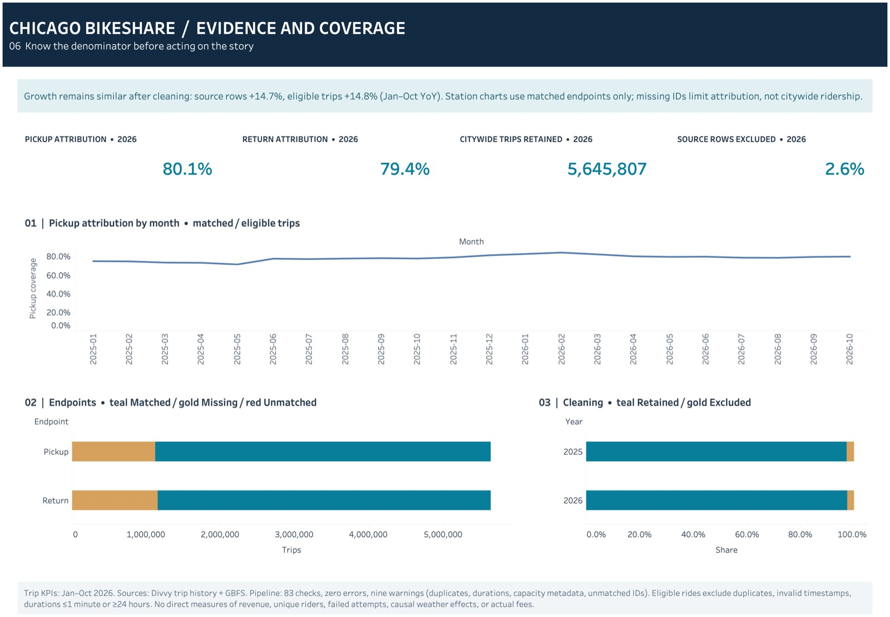
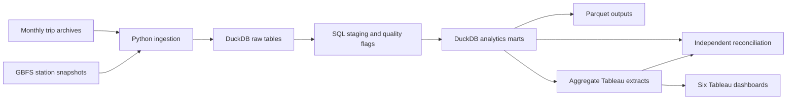

# Chicago Bikeshare Atlas

A portfolio project exploring how Chicago-area Divvy bikeshare demand changed, where trips create station imbalances, and what the data can support about day-to-day operations. I combined monthly trip records and station availability snapshots in a Python and DuckDB pipeline, then built six Tableau dashboards around the results.

[Download the Tableau workbook](./Chicago%20Bikeshare%20Atlas.twbx?raw=true) · [Explore the dashboards](#dashboard-guide) · [Reproduce the pipeline](#reproduce-the-pipeline)

## What the data shows

- Eligible rides rose from **4,916,470** to **5,645,807** across January–October 2025 and January–October 2026, an increase of **14.8%**. E-bike rides grew by 917,738 while classic-bike rides fell by 188,401.
- In the 2026 comparison window, **80.1% of pickups** and **79.4% of returns** could be attributed to stations. Station analyses use matched endpoints.
- Operations Snapshot uses the feed observed on **November 23, 2026 at 6:59 a.m. Chicago time**. Its bike and dock counts describe conditions at that observation.



## Dashboard guide

| Tab | Business question |
| --- | --- |
| Business Pulse | How much did trip volume grow, and which bike and rider segments contributed? |
| Rider Rhythm | When do members and casual riders travel, and how long are their trips? |
| Station Atlas | Where do pickups and returns concentrate, and how does activity change by station? |
| Demand and Flow | Which stations have the largest net departures or arrivals, and at what hours? |
| Operations Snapshot | Which dock candidates had few bikes or return spaces at the saved observation? |
| Evidence and Coverage | How much data survived cleaning, and which endpoints could be attributed to stations? |

The six dashboards share one packaged workbook. In Tableau Desktop, begin with **Business Pulse**. In **Station Atlas**, select a station to drill into its pickup and return patterns.

## Architecture



Ingestion uses source checksums and watermarks to track processed inputs. Staging preserves quality flags, and the marts separate trip-start cohorts from station pickup and return events.

## Validation and interpretation

- **44 reconciliation and integrity checks passed** for the released workbook. They cover comparable-period totals, station events, rate denominators, and the packaged extracts. The warehouse run reported 83 checks with zero errors and nine warnings. [Release validation results](docs/validation-report.json)
- The eligible-trip growth estimate was **14.8%** after cleaning, compared with **14.7%** using source rows. The analysis excludes duplicates, invalid timestamps, and rides lasting one minute or less or 24 hours or more.
- Station flow counts matched returns minus matched pickups. The trip and station feeds do not track operator moves, failed rental attempts, or actual fees. The operations shortlist is a screening tool based on observed scarcity and historical demand.

## Reproduce the pipeline

1. Create a Python environment and install the dependencies.

   ```bash
   python3 -m venv .venv
   .venv/bin/python -m pip install -r requirements.txt
   ```

2. Download the official monthly trip archives for January 2025 through October 2026. Create a local `data/` directory and put the archives or extracted `*-divvy-tripdata.csv` files in it. [Divvy system data](https://divvybikes.com/system-data)
3. Run the pipeline, build the Tableau workbook, and reconcile its aggregates against the warehouse.

   ```bash
   .venv/bin/python scripts/run_pipeline.py --fetch-live
   .venv/bin/python scripts/build_tableau_atlas.py
   .venv/bin/python scripts/validate_tableau_atlas.py
   ```

4. Open `data/processed/tableau/atlas/Chicago Bikeshare Atlas.twbx` in Tableau Desktop. The package contains all six dashboards and their supporting aggregate data. The operations snapshot reflects the feed fetched during your run. Current station metadata can also change which historical endpoints are matched.

## Documentation

- [Pipeline](PIPELINE.md) explains ingestion, schema layers, checkpoints, validation, and the Tableau build.
- [Data dictionary](DATA_DICTIONARY.md) defines the grain and purpose of warehouse tables.
- [Transformation decisions](TRANSFORMATION_DECISIONS.md) describes the cleaning rules and how to interpret station metrics.

This is an independent, noncommercial analysis. The underlying source data is made available under the [Divvy Data License Agreement](https://divvybikes.com/data-license-agreement).
